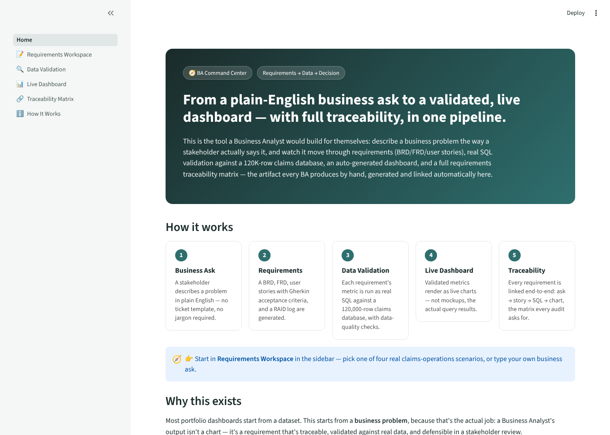
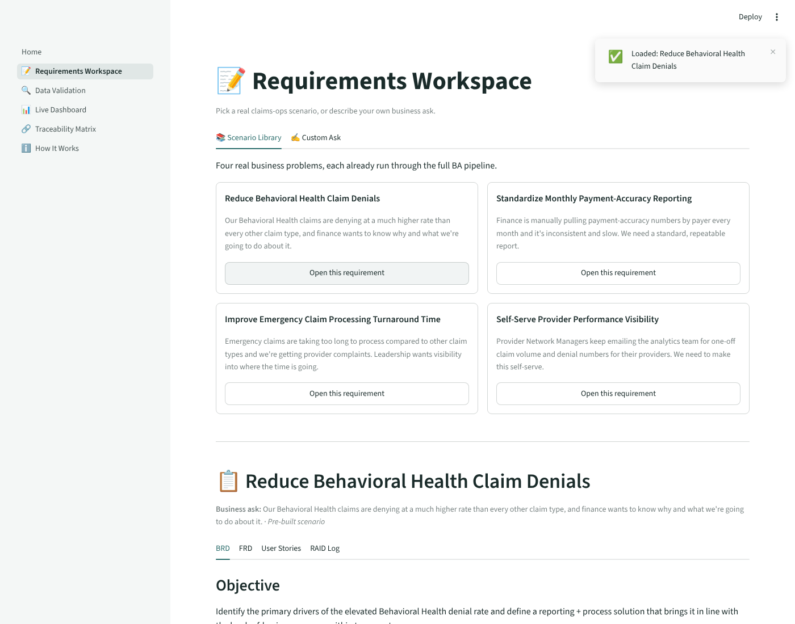
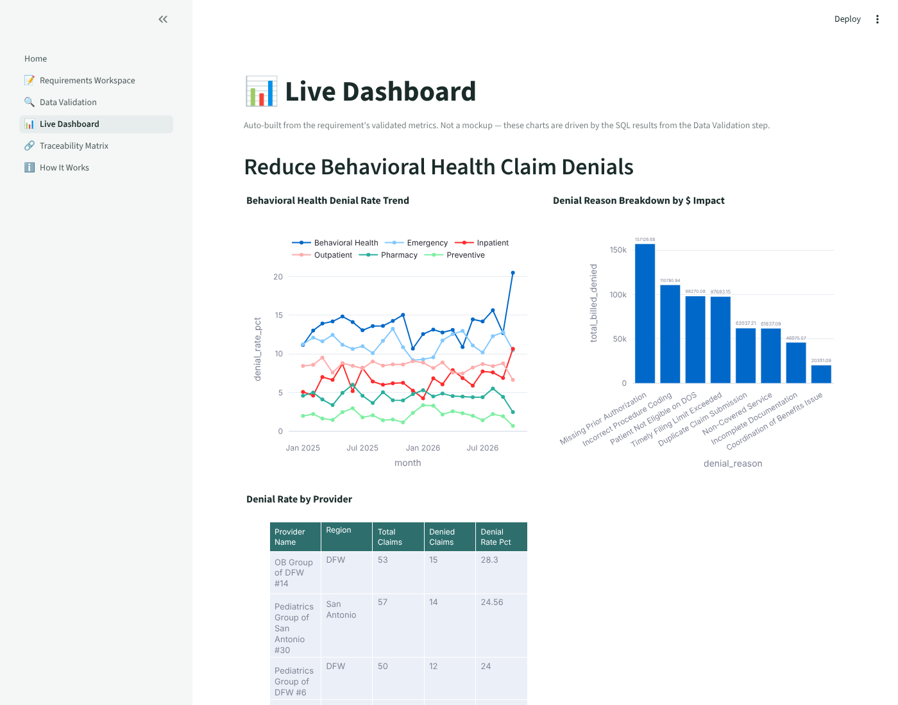
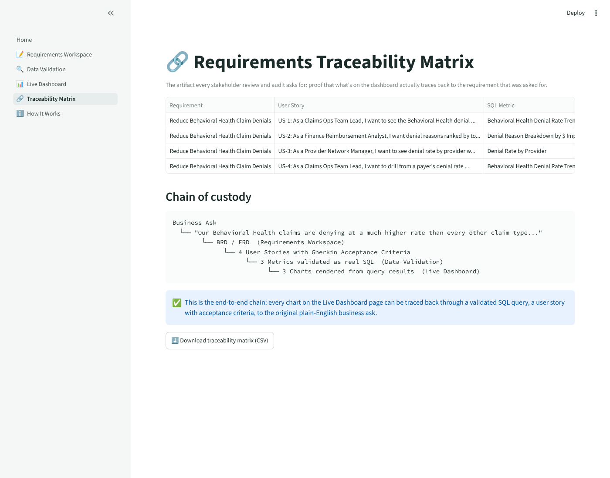

# BA Command Center

**A plain-English business ask, run end-to-end: requirements → real SQL validation → live dashboard → full traceability matrix — in one pipeline.**

Most portfolio data projects start from a dataset. This one starts from a *business problem*, because that's the actual job: a Business Analyst's output isn't a chart, it's a requirement that's structured, validated against real data, and defensible in a stakeholder review.



## What it does

A stakeholder describes a problem the way they actually would — no ticket template, no jargon required — and the tool runs it through the full BA delivery chain:

1. **Requirements** — a BRD (objective, scope, success metrics, stakeholders), an FRD (numbered functional/non-functional requirements, data requirements), user stories with Gherkin-style Given/When/Then acceptance criteria, and a RAID log.
2. **Data Validation** — each requirement's metric is run as a real parameterized SQL query against a normalized, 120,000-row relational database (claims, providers, payers, denials — not a flat CSV), with null-rate and IQR outlier checks shown alongside the query.
3. **Live Dashboard** — charts are generated from the requirement's declared metrics and rendered from the actual query results, not mocked.
4. **Traceability Matrix** — the artifact every stakeholder review and audit asks for: Requirement → User Story → SQL Metric → Dashboard Widget → Status, all linked automatically.



## Two ways to generate requirements

- **Scenario Library** — four fully-worked, real claims-operations business problems (denial-rate spikes, payment-accuracy reporting, processing turnaround time, provider visibility) ship pre-built, so the demo is always instant and reliable.
- **Custom Ask** — type your own business problem. Bring your own OpenAI-compatible API key for live LLM generation, or leave it blank and a transparent rule-based extractor still produces a structurally complete package. The tool never just errors out.





## Why it's built this way

- **The database is real and relational.** 120,000 claims, 180 providers, 8 payers, and a separate denials table joined by foreign key — every chart is the output of an actual `JOIN`/`GROUP BY` query, visible in full on the Data Validation page.
- **The requirements are structured artifacts, not AI prose.** A BRD with explicit in/out of scope, an FRD with numbered functional requirements, Gherkin acceptance criteria, and a RAID log — the documents a BA is actually evaluated on.
- **Reliability over flash.** The Scenario Library means a recruiter clicking through this never hits a broken API call or an empty state.
- **The AI agent architecture is genuinely live**, not decorative — Custom Ask mode will call a real model if you give it a key.

## Tech stack

Python · Streamlit · SQLite · Pandas · Plotly · OpenAI SDK (optional, bring-your-own-key)

## Project structure

```
.
├── Home.py                          # Landing page
├── pages/
│   ├── 1_Requirements_Workspace.py  # Scenario library + custom ask → BRD/FRD/stories/RAID
│   ├── 2_Data_Validation.py         # Real SQL execution + data-quality checks
│   ├── 3_Live_Dashboard.py          # Plotly charts generated from validated metrics
│   ├── 4_Traceability_Matrix.py     # Requirement → Story → SQL → Chart
│   └── 5_How_It_Works.py            # Architecture explainer
├── core/
│   ├── scenarios.py                 # 4 pre-built BA requirement packages
│   ├── requirements_agent.py        # Live LLM + rule-based fallback generator
│   ├── sql_validator.py             # Metric → SQL query map + data-quality checks
│   ├── dashboard_builder.py         # Metric → Plotly chart
│   └── traceability.py              # Builds the traceability matrix
├── data/
│   ├── build_db.py                  # Builds the 120K-row relational claims database
│   └── claims_ops.db                # Generated SQLite database
└── requirements.txt
```

## Running it locally

```bash
git clone https://github.com/harikrupa-ai/ba-command-center.git
cd ba-command-center
pip install -r requirements.txt
streamlit run Home.py
```

The app opens at `http://localhost:8501`. The database builds automatically on first run if `data/claims_ops.db` isn't present.

## Data

The claims database (`data/claims_ops.db`) is **entirely synthetic**, generated by `data/build_db.py` with a fixed random seed for reproducibility — no real patient, provider, or payer records anywhere in this project. Claim amounts, denial rates, and processing times are modeled on realistic healthcare-claims patterns.

## Author

**Hari Krupa Cheguri** — Business Analyst with 5+ years across health insurance, banking, and enterprise analytics.
[LinkedIn](https://linkedin.com/in/krupa-ch-57308220b) · [GitHub](https://github.com/harikrupa-ai)
